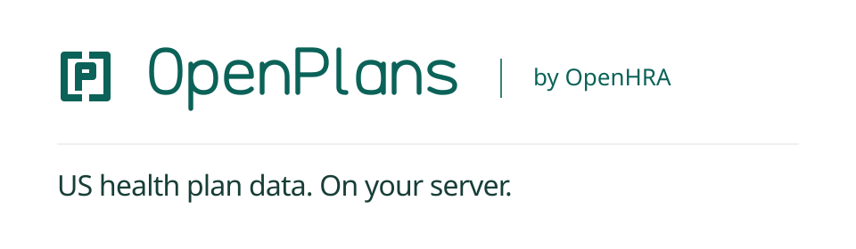

# OpenPlans

US health plan data you can host yourself.

OpenPlans turns public CMS, Census, NPPES, NLM RxNorm and insurer files into an HTTP API and an
MCP endpoint for ACA marketplace plans, premium quotes, subsidy estimates, drug coverage and
provider networks. It runs in Docker on your own server. You can trace every answer to the public
file it came from.

Project page: <https://plans.openhra.com/> · Part of [OpenHRA](https://www.openhra.com/).

> **Status: public preview.** Tagged releases are on the
> [releases page](https://github.com/openhra/openplans/releases). Expect changes on `develop`
> between releases.

> **Public quoting is on by default.** Every install answers anonymous quotes by age and ZIP at
> `POST /v1/quotes` and through the MCP tool `quote_plans`. Set `OPENPLANS_PUBLIC_QUOTING=off` to
> turn both off. Household quotes with income, at `POST /v1/premium-quotes` and through
> `quote_premiums`, are on by default too. Set a token to restrict them, or
> `OPENPLANS_PUBLIC_HOUSEHOLD=off` to turn them off.

[Get started with Docker, call the API and check coverage](docs/usage.md) ·
[quoting guide](docs/quoting.md) · [self-hosting guide](docs/self-host.md).

## What it answers

| Question | Source |
|---|---|
| Which plans are sold for this ZIP and county? | CMS Exchange public use files, Census ZCTA files |
| What does a plan cost at these ages in this ZIP? | Filed rate tables, no token needed |
| What does this household pay, with income? | Filed rate tables (federal age curve; NY and VT PY2026 family tiers), with a token |
| What subsidy might apply? | Benchmark plan, expected contribution, Form 8962 rounding |
| Is this drug covered, at what tier? | Insurer formulary files, NLM RxNorm |
| Is this provider in the plan's network? | Insurer provider files, CMS NPPES |

## Principles

- OpenPlans uses public sources only and keeps attribution and provenance for every row.
- OpenPlans never invents data. Missing, blocked or incomplete evidence is `unknown`, never
  "not covered".
- Public quotes take ages, a ZIP or county and an optional tobacco flag. They refuse income,
  dates of birth and names. The API never logs request bodies, ages or ZIP codes.
- The fetcher reads each host's `robots.txt` and downloads only after a person has reviewed the
  publisher's terms.
- Host it yourself with Docker Compose, PostgreSQL and PostGIS. Services bind to `127.0.0.1`.
- We compare releases value by value against the raw public files.

## Contributing

See [CONTRIBUTING.md](CONTRIBUTING.md). For security issues, see [SECURITY.md](SECURITY.md).
For questions, use the contact section of <https://www.openhra.com/#contact>.

## License

Apache License 2.0. See [LICENSE](LICENSE) and [NOTICE](NOTICE). Public datasets keep their
publishers' terms; OpenPlans downloads them at install time and does not redistribute them.
