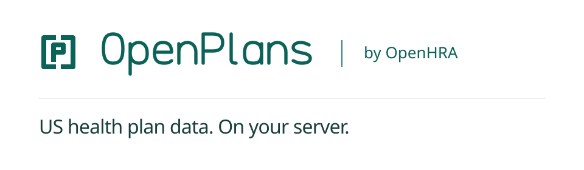

# OpenPlans

Search public health-plan data on your own server.

OpenPlans serves data from CMS, Census, NPPES, NLM RxNorm and insurer files through HTTP and
MCP. Search ACA marketplace plans, quote premiums, estimate subsidies and check drug and
provider evidence. It also serves Medicare catalogs and benefits where CMS releases are loaded.
Part D drug data is off until the operator reviews its terms and enables it. It runs in Docker on your own server. You can trace every answer to the public
file it came from.

Project page: <https://plans.openhra.com/> · Part of [OpenHRA](https://www.openhra.com/).

> **Status: public preview.** Tagged releases are on the
> [releases page](https://github.com/openhra/openplans/releases). Expect changes on `develop`
> between releases.

> **Public quoting is on by default.** Every install answers anonymous quotes by age and ZIP at
> `POST /v1/quotes` and through the MCP tool `quote_plans`. Set `OPENPLANS_PUBLIC_QUOTING=off` to
> turn both off. Household quotes with income, at `POST /v1/premium-quotes` and through
> `quote_premiums`, are on by default too. Set the REST or MCP token to restrict
> that protocol. With no token, `OPENPLANS_PUBLIC_HOUSEHOLD=off` closes household access.

[Get started with Docker, call the API and check coverage](docs/usage.md) ·
[quoting guide](docs/quoting.md) · [self-hosting guide](docs/self-host.md).

## What it answers

| Question | Source |
|---|---|
| Which plans are sold for this ZIP and county? | CMS Exchange public use files, Census ZCTA files |
| What does a plan cost at these ages in this ZIP? | Filed rate tables, no token needed |
| What does this household pay, with income? | Filed rate rows and cited state rules, including NY and VT PY2026 family tiers; open unless a token is configured |
| What subsidy might apply? | Benchmark plan, expected contribution, Form 8962 rounding |
| Is this drug covered, at what tier? | Insurer formulary files, NLM RxNorm |
| Is this provider in the plan's network? | Insurer provider files, CMS NPPES |

## Principles

- OpenPlans uses public sources only and keeps attribution and provenance for every row.
- OpenPlans never invents data. Missing, blocked or incomplete evidence is `unknown`, never
  "not covered".
- Public quotes take ages, a ZIP or county and an optional tobacco flag. They refuse income,
  dates of birth and names. The API never logs request bodies, ages or ZIP codes.
- The fetcher reads each host's `robots.txt` and downloads only after a person has reviewed the
  publisher's terms.
- Host it yourself with Docker Compose, PostgreSQL and PostGIS. Services bind to `127.0.0.1`.
- Use the Node.js version pinned in `.node-version` for the image and native tools.
- Before a release, independent checks compare the stored rates with the 2026 and 2027 public
  rate files for every state those files cover. Cost-sharing, household premium and dental checks
  have run for Texas only so far. The
  [Verification section](https://plans.openhra.com/#verification) of the project site lists each
  check and its result.

## Contributing

See [CONTRIBUTING.md](CONTRIBUTING.md). For security issues, see [SECURITY.md](SECURITY.md).
For questions, use the contact section of <https://www.openhra.com/#contact>.

## License

Apache License 2.0. See [LICENSE](LICENSE) and [NOTICE](NOTICE). Public datasets keep their
publishers' terms; OpenPlans downloads them at install time and does not redistribute them.
